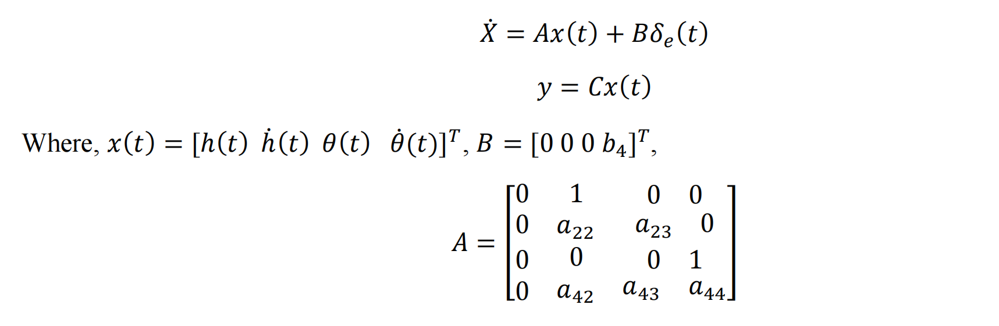
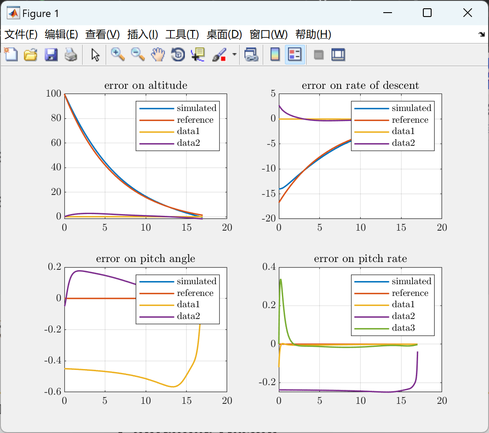
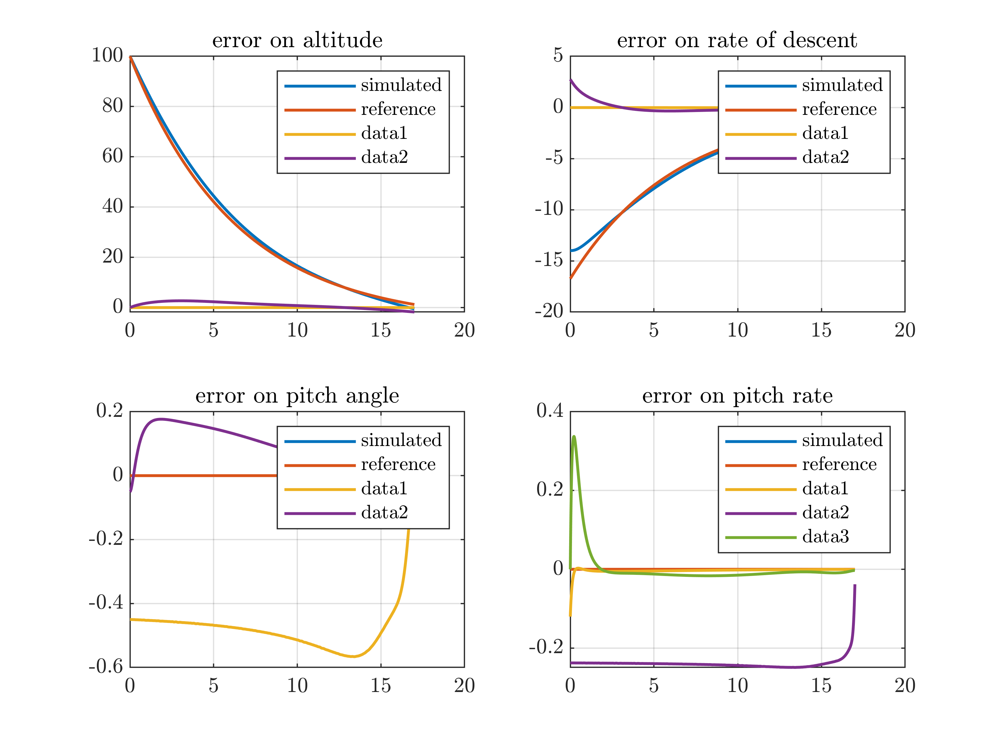
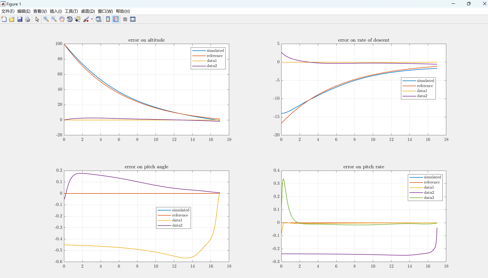
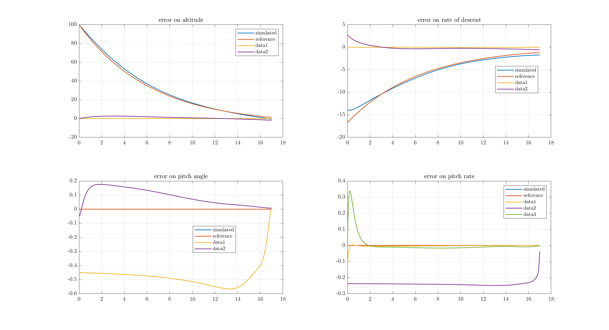
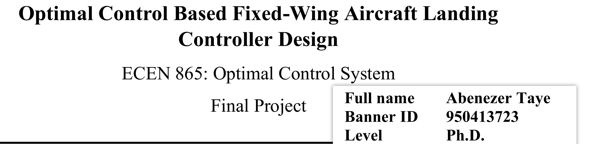

# Research on the Design of Landing Controller for Optimally Controlled Fixed-Wing Aircraft Based on Matlab Code (Implementation)

💥💥💞💞 Welcome to this blog❤️❤️ 💥💥
🏆 Bloggers' Advantages: 🌞🌞🌞 The content of the blog strives for rigorous thinking and clear logic, making it convenient for readers.
⛳️ Mantra: A journey of a thousand miles is begun with a single step.
📋📋📋 This article's outline is as follows: 🎁🎁🎁 Outline 💥1 Overview📚
2 Run Results🎉
3 References🌈
4 Matlab Code and Article

Abstract
One of the most challenging tasks in aircraft control is achieving safe and comfortable landing. Accident statistics show that over 45% of general aviation accidents occur during the takeoff and landing phases. Further analysis reveals that more than 90% of accidents are caused by pilot errors. Uncontrolled flight is also a major factor in 33% of these accidents. In many cases, accidents occur because they fail to land within the target landing time. In this project, we designed a longitudinal controller for a fixed-wing aircraft to track the desired landing trajectory, assuming that the aircraft's horizontal and vertical dynamics are decoupled, and that the horizontal controller handles the deviation from the runway centerline.
Introduction
The landing process of an airplane consists of five different stages: basic legs, slope, climb, landing, and roll after landing. Among these stages, the slope and climb stages are the most critical [1]. In this project, we designed a tracking controller to guide the aircraft towards a smooth and comfortable landing. We considered the pitch stage in this project. The system model used in this paper comes from [1]. In this paper, we consider the motion model of the aircraft. To obtain the system model, we made the following assumptions: wind disturbances are assumed to be zero, deviation from equilibrium flight state is assumed to be zero, the slope path angle is assumed to be small enough to allow for small angle approximation, the aircraft speed is constant, longitudinal movement is controlled by flap deflection, and lateral movement is ignored. For details, see section 4.
📚2 Run Results​
​
​
Main function code:
Parameters % Load the given parameters
%sinit = zeros(10,1); % S(tf) = C'PC, where C is eye(4). And P=[0.9 0 0 0;0 0.01 0 0;0 0 1 0;0 0 0 1]  
s0 = [0.9 0 0 0 0.042 0 0 1 0 1];  
v0 = [0,0.000142,0,0]';  
%First solve for S using the DRE  
[t1,s] = ode45(@DRE_S,[-Tf:0.01: 0],s0);  
sf = flipud(s);  
%calculate K using K = inv(R)*B'*S(t)  
for i =1:length(s)  
Kf(i,:)= (1/r)*B'*[sf(i,1) sf(i,2) sf(i,3) sf(i,4);  
sf(i,2) sf(i,5) sf(i,6) sf(i,7);  
sf(i,3) sf(i,6) sf(i,8) sf(i,9);  
sf(i,4) sf(i,7) sf(i,9) sf(i,10)];  
end  
%solve for V using the DRE  
[t2,v] = ode45(@(t,v) DRE_V(t,v,Kf,t1),[-Tf:0.01: 0],v0);  
%closed loop simulation  
tt = -flipud(t2);  
vf = flipud(v);  
%calucalte xdot  
[tx, x] = ode45(@(t,x) Xstates(t,x,tt,vf,tt,Kf),[0:0.01:Tf],x0);  
%calculate control input  
for i=1:length(x)  
u(i) = -Kf(i,:)*x(i,:)' + (1/r)*B'*vf(i,:)';  
end  
plot(tx,u,'LineWidth',1.2 )  
grid on  
title('elevator defelection angle')  
reference = desired_trajectory(Tf);  
subplot(2,2,1)  
plot(tx,x(:,1),'LineWidth',1.2 )  
hold on  
plot(tx,reference(1,:),'LineWidth',1.2 )  
grid on  
legend('simulated','reference')  
title('altitude')  
subplot(2,2,2)  
plot(tx,x(:,2),'LineWidth',1.2 )  
hold on  
plot(tx,reference(2,:),'LineWidth',1.2 )  
grid on  
legend('simulated','reference')  
title('rate of descent')  
subplot(2,2,3)  
plot(tx,x(:,3),'LineWidth',1.2 )  
hold on  
plot(tx,reference(3,:),'LineWidth',1.2 )  
grid on  
legend('simulated','reference')  
title('pitch angle')  
subplot(2,2,4)  
plot(tx,x(:,4),'LineWidth',1.2 )  
hold on  
plot(tx,reference(4,:),'LineWidth',1.2 )  
grid on  
legend('simulated','reference')  
title('pitch rate')  
%  
plot(tx,u,'LineWidth',1.2 )  
grid on  
title('elevator defelection angle')  
%%  
subplot(2,2,1)  
plot(tx,Kf(:,1),'LineWidth',1.2 )  
grid on  
title('altitude gain')  
subplot(2,2,2)  
plot(tx,Kf(:,2),'LineWidth',1.2 )  
grid on  
title('rate of descent gain')  
subplot(2,2,3)  
plot(tx,Kf(:,3),'LineWidth',1.2 )  
grid on  
title('pitch angle gain')  
subplot(2,2,4)  
plot(tx,Kf(:,4),'LineWidth',1.2 )  
Grid on
Title('Pitch Rate Gain')
%%
subplot(2,2,1)
e1 = x(:,1)-reference(1,:); 
plot(tx,e1,'LineWidth',1.2)
grid on
Title('Error on Altitude')
subplot(2,2,2)
e2 = x(:,2)-reference(2,:); 
plot(tx,e2,'LineWidth',1.2)
grid on
Title('Error on Rate of Descent')
subplot(2,2,3)
e3 = x(:,3)-reference(3,:); 
plot(tx,e3,'LineWidth',1.2)
grid on
Title('Error on Pitch Angle')
subplot(2,2,4)
e4 = x(:,4)-reference(4,:); 
plot(tx,e4,'LineWidth',1.2)
grid on
Title('Error on Pitch Rate')
🎉3 References
🌈4 Matlab Code and Articles

## Images

<!-- PAYMENT_BLOCK -->

## Get this dataset

- Payment link (Stripe): [Buy now](https://buy.stripe.com/3cs8yP7sY87d0vu9AB)
- Payment QR code: 

<!-- /PAYMENT_BLOCK -->
